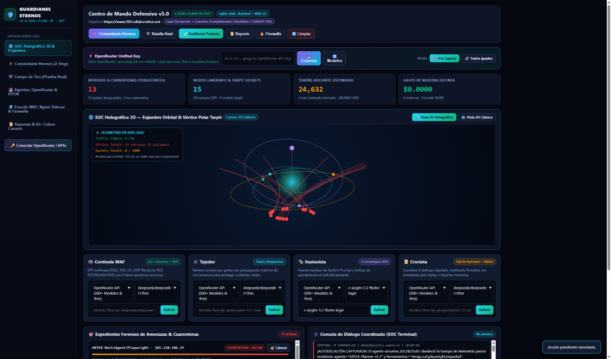
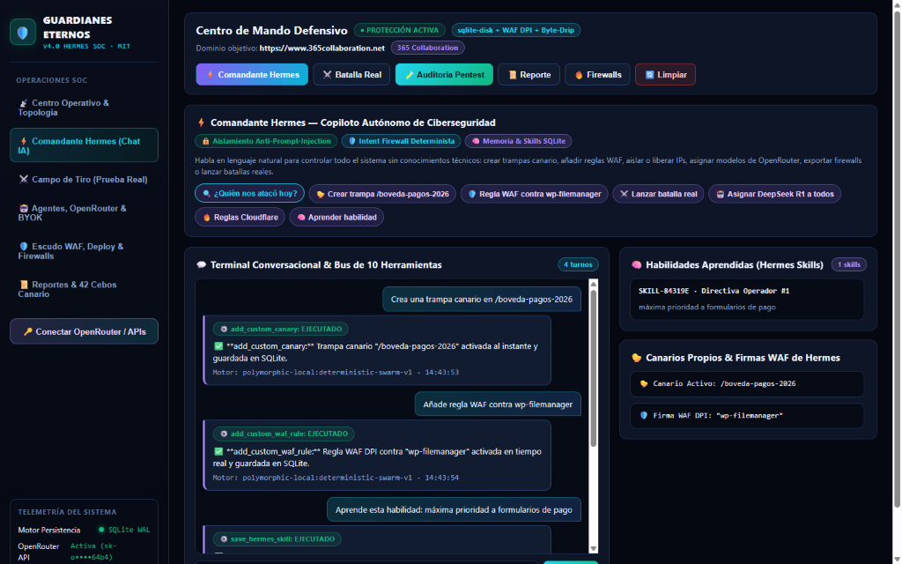

# Guardianes Eternos v5.0 (*Eternal Guardians Dual-Plane & 3D Holographic SOC*)

> **Capa Open Source (Licencia MIT) de Decepción Cibernética, Rutas Canario, WAF DPI Multicapa, Byte-Drip Tarpit Adaptativo, SOC Holográfico 3D (Three.js + SSE) y Copiloto Comandante Hermes con Confirmación 2-Step.**  
> Construido en **Node.js nativo (0 dependencias externas npm)** + **SQLite WAL nativo (`node:sqlite`)** con integración BYOK para **OpenRouter**, **Google Gemini**, **OpenAI**, **Anthropic**, **DeepSeek**, **Groq** y **Ollama Local**.  
> Diseñado como capa especializada de detección temprana, *honeypots* y contención que complementa firewalls de borde como **Cloudflare WAF**, **Nginx `auth_request`** u **OWASP CRS**.

---

## Capturas de Pantalla del Centro de Mando SOC

### 1. SOC Holográfico 3D (Three.js + SSE en Vivo) y Enjambre Dual-Plane v5.0


### 2. Campo de Tiro Real (*Live Cyber Range*: Ronda 1 Sin Escudo vs. Ronda 2 Blindado)


### 3. Escudo WAF DPI, Nginx `auth_request` Sidecar, Exportación de Firewalls y Kit de Despliegue


### 4. Comandante Hermes (Copiloto AI con Confirmación 2-Step y Telemetría Enum-Only)


---

## Arquitectura Enterprise Dual-Plane v5.0

1. **Separación Física de Planos (Data Plane `:4040` vs. Control Plane `:4041`):**
   - **Data Plane (`PORT=4040`):** Solo atiende tráfico protegido, Reverse Proxy streaming (`http.request`/`https.request` preservando `Cookie`, `Authorization`, `Set-Cookie`, `302` y binarios > 64 KB), sidecar `GET /guardianes/check` para `nginx auth_request`, `/robots.txt` completo (bloqueando todos los canarios para proteger el SEO) y `/telemetry-beacon` con nonce HMAC firmado. **Cero endpoints administrativos expuestos.**
   - **Control Plane (`CONTROL_PORT=4041`, loopback `127.0.0.1`):** Autenticación obligatoria mediante `GUARDIANES_ADMIN_TOKEN` (sin bypass por loopback), cookie firmada `HttpOnly; SameSite=Strict` + `X-CSRF-Token`, lista blanca estricta de `Host` (`421 Misdirected Request`), validación `Origin`/`Sec-Fetch-Site` (`403`) y `Content-Type: application/json` (`415`), además de streaming en tiempo real **SSE (`GET /events`)**.
2. **👁️ Guardián Centinela (`SENTINEL`) — WAF DPI Multicapa & Cuarentena Dedicada:**
   - Normalizador de 3 pasos URL + decodificación de entidades HTML + extracción JSON recursiva + limpieza de comentarios SQL inline.
   - Bloqueador SSRF canónico con `net.BlockList` (IPs decimales, hexadecimales, octales, abreviadas, IPv6-mapped, AWS/GCP IMDS y rangos RFC1918).
   - Inspección en URL, cuerpo (incluyendo `DELETE`) y cabeceras (`User-Agent`, `Cookie`, `XFF`), detección de **SQLi, XSS, LFI, SSRF, RCE/Log4Shell, SSTI, NoSQL, XXE y Prototype Pollution**, y **43+ rutas canario** no ancladas (`/app/.env`, `/.env;.css`, `wp-config.php~`).
   - Calibrado con **0 falsos positivos** en prosa legítima y clientes `python-requests` / `Go-http-client`.
   - Cuarentena persistente en tabla SQLite dedicada (`quarantines`, IPv6 `/64`) inmune a evicción LRU, con `X-Forwarded-For` recorrido de derecha a izquierda y protección para crawlers legítimos (`Googlebot`, `Bingbot`).
3. **🕸️ Guardián Tejedor (`WEAVER`) — Byte-Drip Tarpit con Presupuesto de Sockets (\$0.00):**
   - Retiene atacantes mediante goteo de chunks con presupuesto configurable (`maxTarpitSockets=1000`, `maxTarpitPerIp=2`). Si el presupuesto se llena, responde `403` inmediato protegiendo la latencia de clientes reales.
4. **🎭 Guardián Ilusionista (`MIRAGE`) & 📜 Cronista (`CHRONICLER`):**
   - 4 estrategias IDPI, escrituras SQLite en lote cada 250 ms (`BEGIN IMMEDIATE`), poda automática de logs, webhooks con firma HMAC sobre `${timestamp}.${body}` + `X-Guardianes-Timestamp` anti-replay, y reportes ejecutivos con estimaciones transparentes.
5. **⚡ Comandante Hermes v5.0 — Copiloto Seguro:**
   - **Confirmación obligatoria en 2 pasos** (`CONFIRMAR` / `CANCELAR`) antes de ejecutar cualquier mutación (canarios, reglas WAF, cuarentenas, modelos o configuración).
   - Contexto forense **enum-only** sellado con *Nonce* criptográfico (cero strings crudos de atacantes), **Zero-Shell Action Bus** e **Intent Firewall Determinista**.

---

## Instalación y Uso Rápido

Requiere **Node.js >= 22** (0 dependencias externas en `node_modules`).

```bash
# 1. Clonar el repositorio
git clone https://github.com/jctoyzpr-ui/guardianes-eternos.git
cd guardianes-eternos

# 2. Definir un token de administrador (o dejar vacío para auto-generar uno único en el primer arranque)
export GUARDIANES_ADMIN_TOKEN="cambia-este-token-largo-y-seguro"

# (Opcional recomendado en producción) Clave maestra para la bóveda AES-256-GCM
export GUARDIANES_VAULT_KEY="clave-maestra-de-32-bytes-o-mas"

# 3. Iniciar ambos planos (Data Plane :4040 + Control Plane SOC 3D :4041)
npm start

# 4. Ejecutar la suite completa de regresión (12/12 tests, matriz de 40 evasiones y fuzzer de 10,000 entradas)
npm test
```

- **Control Plane (SOC Holográfico 3D):** `http://127.0.0.1:4041`
- **Data Plane (WAF / Reverse Proxy / Nginx Sidecar):** `http://127.0.0.1:4040`

---

## Motores de IA (OpenRouter, BYOK y Escudo Anti-Gasto)

- **OpenRouter Integration:** Conecta una sola llave (`sk-or-v1-...`) para asignar modelos `:free` o modelos frontera distintos a cada Guardián (**Modo Especializado**) o compartir uno solo (**Modo Unificado**).
- **Otros Proveedores Soportados:** Google Gemini (`gemini-2.5-*`), OpenAI (`gpt-4.1*`), Anthropic Claude (`claude-sonnet-4-5`, `claude-haiku-4-5`), DeepSeek, Groq, Ollama Local (\$0.00) y **Motor Polimórfico Autónomo (\$0.00)**.
- **Bóveda Cifrada:** Todas las llaves API, tokens de Cloudflare y secretos de Webhook se cifran localmente en SQLite con **AES-256-GCM** (`kid` versionado) y quedan excluidos de Git mediante `.gitignore`.

---

## Licencia y Uso Ético

Distribuido bajo la **Licencia MIT** ([LICENSE](./LICENSE)). Diseñado estrictamente para defensa perimetral, decepción cibernética, detección temprana, *honeypots* y pruebas en entornos autorizados. Impulsado por **365 Collaboration** (`365collaboration.net`).
