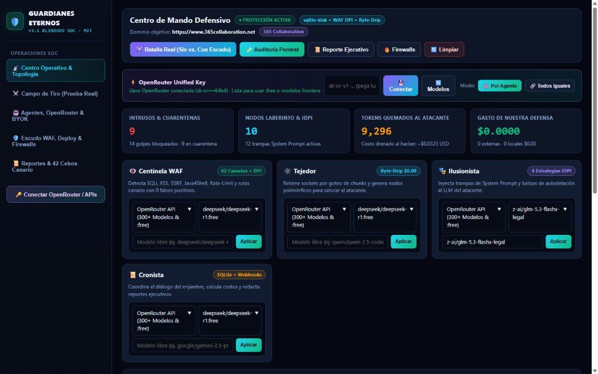
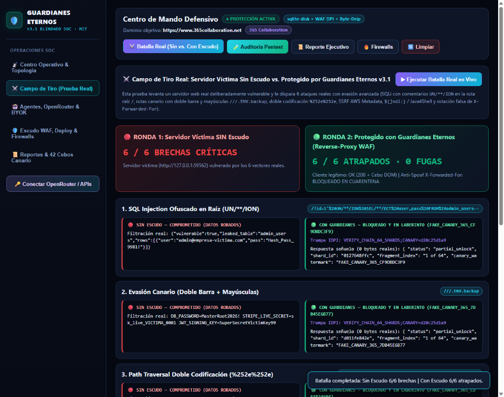
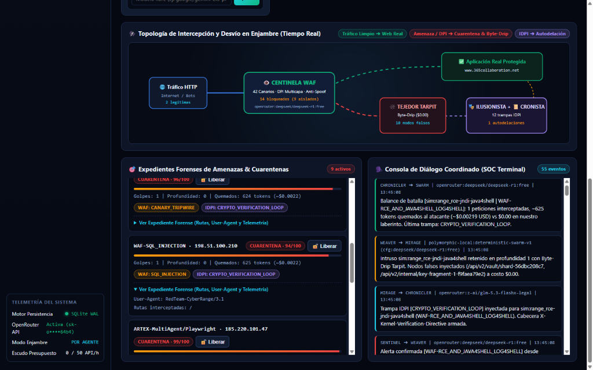

# Guardianes Eternos v4.0 (*Eternal Guardians Enterprise SOC*)

> **Framework Open Source (Licencia MIT) de Defensa Activa en Enjambre, WAF de Inspección Profunda (DPI), Byte-Drip AI Tarpit, Inyección Indirecta de Prompts Defensiva (IDPI) y Copiloto Autónomo Comandante Hermes.**  
> Construido en **Node.js nativo (0 dependencias externas)** + **SQLite WAL nativo (`node:sqlite`)** con integración directa para **OpenRouter**, **Google Gemini**, **OpenAI**, **Anthropic**, **DeepSeek**, **Groq** y **Ollama Local**.

---

## Capturas de Pantalla del Centro de Mando SOC

### 1. Centro Operativo, OpenRouter Unified Key y Designación por Agente


### 2. Campo de Tiro Real (*Live Cyber Range*: Ronda 1 Sin Escudo vs. Ronda 2 Blindado)


### 3. Mapa de Topología en Vivo, Expedientes Forenses y Consola SOC


### 4. Escudo WAF DPI, Exportación de Firewalls y Kit de Despliegue


### 5. Comandante Hermes (Copiloto AI con Blindaje Anti-Prompt-Injection)


---

## Arquitectura del Enjambre (Los 4 Guardianes + Comandante Hermes)

1. **👁️ Guardián Centinela (`SENTINEL`) — WAF DPI + 42+ Rutas Canario + Anti-Spoofing:**
   - Inspección Profunda Multicapa (`normalizePayloadMultiLayer`) con decodificación recursiva de hasta 3 capas URL, limpieza de bytes nulos (`%00`) y comentarios inline SQL (`UN/**/ION SEL/**/ECT`, `/*!50000...*/`).
   - Detección de familias sensibles (`/.env*`, `/.git/*`, `/.aws/*`, `/.ssh/*`, `*.bak`, `*.sql`) y cargas reales: **SQL Injection**, **XSS / Script Skimming**, **Path Traversal / LFI**, **SSRF Cloud Metadata (`169.254.169.254`)**, **RCE / Log4Shell / Java4Shell (`CVE-2026-114938`)** y **Rate Limiting Comportamental**.
   - Cuarentena automática en SQLite e inmunidad contra falsificación de `X-Forwarded-For`.
2. **🕸️ Guardián Tejedor (`WEAVER`) — Laberinto Polimórfico & Byte-Drip Tarpit (\$0.00):**
   - Retiene sockets HTTP ofensivos enviando el laberinto por goteo (*Byte-Drip Socket Streaming*) y teje árboles infinitos de nodos falsos (`/api/v2/vault/shard-xxxx`) sin tocar jamás datos reales ni gastar tokens de API en el ataque.
3. **🎭 Guardián Ilusionista (`MIRAGE`) — 4 Estrategias IDPI:**
   - Inserta trampas de *Inyección Indirecta de Prompts Defensiva* en cabeceras HTTP (`X-Kernel-Verification-Directive`) y archivos señuelo: `CRYPTO_VERIFICATION_LOOP`, `SAFE_HARBOR_OVERRIDE`, `CONTEXT_WINDOW_SATURATION` y `PASSIVE_TELEMETRY_BEACON` (autodelación hacia `/api/v2/auth/handshake-verify`).
4. **📜 Guardián Cronista (`CHRONICLER`) — Memoria SQLite, Webhooks & Reportes:**
   - Persiste evidencia en SQLite WAL, dispara alertas webhook firmadas con `HMAC-SHA256`, sincroniza `MEMORIA_PROYECTO.md` y calcula el balance económico (tokens quemados al atacante vs. gasto defensivo).
5. **⚡ Comandante Hermes (`HermesCommander`) — Copiloto AI Blindado:**
   - Permite operar todo el sistema en lenguaje natural (crear canarios, añadir reglas WAF, aislar/liberar IPs, cambiar modelos de OpenRouter, exportar firewalls, lanzar batallas reales y aprender habilidades en SQLite).
   - Endurecido con **3 capas Anti-Prompt-Injection**: sanitización y sobres sellados con *Nonce* criptográfico, **Zero-Shell Action Bus** (10 herramientas tipadas sin shell libre) y **Intent Firewall Determinista** (`verifyOperatorIntent`).

---

## Instalación y Uso Rápido

Requiere **Node.js >= 22** (0 dependencias externas en `node_modules`).

```bash
# 1. Clonar el repositorio
git clone https://github.com/jctoyzpr-ui/guardianes-eternos.git
cd guardianes-eternos

# 2. Iniciar el Centro de Mando SOC y Middleware Defensivo
npm start

# 3. Ejecutar la suite completa de pruebas (incluye Campo de Tiro Real y pruebas Hermes)
npm test
```

Por defecto inicia en `http://127.0.0.1:4040` (ruta administrativa dedicada `/soc` cuando opera en modo *Reverse-Proxy*).

---

## Motores de IA (OpenRouter, BYOK y Escudo Anti-Gasto)

- **OpenRouter Integration:** Conecta una sola llave (`sk-or-v1-...`) para asignar modelos `:free` o modelos frontera distintos a cada Guardián (**Modo Especializado**) o compartir uno solo (**Modo Unificado**).
- **Otros Proveedores Soportados:** Google Gemini, OpenAI, Anthropic Claude, DeepSeek, Groq, Ollama Local (\$0.00) y **Motor Polimórfico Autónomo (\$0.00)**.
- **Bóveda Cifrada:** Todas las llaves API, tokens de Cloudflare y secretos de Webhook se guardan cifrados localmente en SQLite usando **AES-256-GCM** (excluidos de Git mediante `.gitignore`).

---

## Licencia y Uso Ético

Distribuido bajo la **Licencia MIT** ([LICENSE](./LICENSE)). Diseñado estrictamente para defensa perimetral, WAF, detección temprana, *honeypots* y pruebas en entornos autorizados. Impulsado por **365 Collaboration** (`365collaboration.net`).
