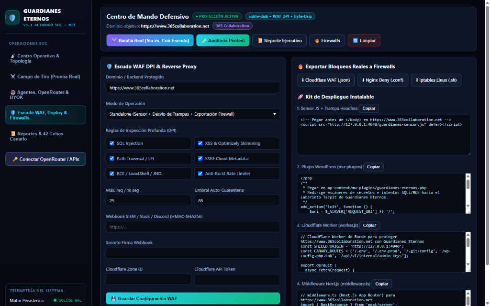

# Guardianes Eternos v5.1 (*Active Cyber Deception, Canary Tripwires & 3D Holographic SOC*)

> **Capa Open Source (Licencia MIT) de Decepción Cibernética, 43+ Rutas Canario, Laberinto Polimórfico con Byte-Drip Tarpit Adaptativo, Trampas IDPI, Detector Estructural Complementario y SOC Holográfico 3D (Three.js + SSE).**  
> Construido en **Node.js nativo (0 dependencias externas npm)** + **SQLite WAL nativo (`node:sqlite`)**.
>
> **Posicionamiento honesto:** Guardianes Eternos está diseñado como una **capa de engaño, detección temprana y contención** (*honeypots*, canarios, laberinto y tarpit) para colocarse **junto a un WAF de borde probado** como **Cloudflare WAF**, **Nginx + OWASP CRS / Coraza** o **ModSecurity** — **no** como reemplazo único de un WAF empresarial completo.

---

## Capturas de Pantalla del Centro de Mando SOC

### 1. SOC Holográfico 3D (Three.js + SSE en Vivo) y Enjambre Dual-Plane


### 2. Campo de Tiro Real (*Live Cyber Range*: Ronda 1 Sin Escudo vs. Ronda 2 Protegido)


### 3. Escudo, Nginx `auth_request` Sidecar, Exportación de Firewalls y Kit de Despliegue


### 4. Comandante Hermes (Copiloto AI con Confirmación 2-Step y Telemetría Enum-Only)


---

## Arquitectura Enterprise Dual-Plane v5.1

1. **Separación Física de Planos (Data Plane `:4040` vs. Control Plane `:4041`):**
   - **Data Plane (`PORT=4040`):** Solo atiende tráfico protegido, Reverse Proxy streaming nativo (`http.request`/`https.request` preservando `Cookie`, `Authorization`, `Set-Cookie`, `302`, binarios, IP real en `X-Forwarded-For` y túnel **WebSocket `101 Switching Protocols`**), sidecar autenticado `GET /guardianes/check` (`X-Guardianes-Sidecar-Secret` + IP de confianza), `/robots.txt` completo y `/telemetry-beacon` con nonce HMAC firmado. **Cero endpoints administrativos expuestos.**
   - **Control Plane (`CONTROL_PORT=4041`, loopback `127.0.0.1`):** Autenticación obligatoria (sin bypass por loopback), rate-limit anti fuerza bruta en `POST /api/auth/login` (`429 Too Many Requests`), cookie firmada `HttpOnly; SameSite=Strict` + `X-CSRF-Token`, lista blanca de `Host` (`421`), validación `Origin`/`Sec-Fetch-Site` (`403`), `Content-Type: application/json` (`415`) y streaming **SSE (`GET /events`)**.
2. **Capa de Decepción & Cuarentena Segura (Motor Local Determinista `$0.00`):**
   - **43+ Rutas Canario no-ancladas** (`/.env*`, `/app/.env`, `/.git/config`, `wp-config.php~`, etc.) bloqueadas en `/robots.txt` para proteger el SEO.
   - **Verificación FCrDNS (fail-closed) para crawlers:** Nunca confía en `User-Agent: Googlebot/Bingbot`; exige DNS inverso + directo verificado antes de otorgar exención.
   - **Cuarentena persistente y no renovable:** Almacenada en tabla SQLite dedicada (`quarantines`, inmune a evicción LRU). Los golpes heurísticos aislados devuelven **bloqueo puntual `403`** sin cuarentena de 24 h; la cuarentena y el Laberinto se reservan para señales deterministas fuertes (canarios, laberinto o `>= 2` señales independientes) y los reintentos bloqueados nunca extienden el plazo.
   - **Byte-Drip Tarpit con presupuesto de sockets:** Límite configurable (`maxTarpitSockets=1000`, `maxTarpitPerIp=2`) que responde `403` inmediato al saturarse para mantener baja latencia en clientes legítimos.
3. **Detector Estructural Complementario (Motor Local `$0.00`):**
   - Tokenizador léxico SQL, parser estructural HTML/XSS (etiquetas reales y eventos `on*=`), extractor SSRF canónico (`http`/`https`/`//`/`http:\\`/`nip.io`/`sslip.io` + `net.BlockList`), analizador de comandos RCE/Log4Shell/SpEL, LFI, SSTI, NoSQL (`\u0024`), XXE y Prototype Pollution.
   - Inspección sobre **todas las cabeceras relevantes** (incluyendo `Accept-Language`, `Cookie`, `User-Agent`) y **cuerpo textual completo** hasta 2 MB con descompresión segura `gzip`/`deflate`/`br` (`node:zlib`), manteniendo binarios intactos.
   - *Nota sobre el modo sidecar Nginx (`auth_request`):* Por diseño de Nginx, `/guardianes/check` inspecciona URI, query y cabeceras (no cuerpos POST) y registra amenazas/cuarentenas en SQLite.
4. **Uso Real y Transparente de IA (OpenRouter / BYOK):**
   - **Qué corre en local (`$0.00`):** Toda la inspección del plano de datos (`Centinela`), el laberinto polimórfico (`Tejedor`) y las 4 estrategias IDPI base (`Ilusionista`) corren de forma determinista local para garantizar baja latencia y evitar Denegación de Billetera.
   - **Dónde participa la IA externa (cuando configuras OpenRouter/BYOK):**
     - **Triaje Forense Asíncrono (`Cronista`):** Al confirmar una nueva cuarentena, ejecuta una llamada asíncrona (datos *enum-only*, respetando `maxApiCallsPerHour`) para clasificar la amenaza y recomendar acción en firewall de borde.
     - **Trampas IDPI Adaptativas (`Ilusionista`):** Genera y cachea localmente directivas señuelo adaptadas a cada familia atacante.
     - **Reportes Ejecutivos y Comandante Hermes v5.1:** Con confirmación obligatoria en **2 pasos**, soporte de instrucciones negativas y contexto *enum-only* sellado con Nonce.

---

## Instalación y Uso Rápido

Requiere **Node.js >= 22** (0 dependencias externas en `node_modules`).

```bash
# 1. Clonar el repositorio
git clone https://github.com/jctoyzpr-ui/guardianes-eternos.git
cd guardianes-eternos

# 2. (Recomendado en producción) Definir secretos largos aleatorios (mínimo 32 bytes hex)
#    Si omites GUARDIANES_ADMIN_TOKEN, se auto-genera uno de 48 hex en el primer arranque.
export GUARDIANES_ADMIN_TOKEN="$(node -e "console.log(require('crypto').randomBytes(24).toString('hex'))")"
export GUARDIANES_VAULT_KEY="$(node -e "console.log(require('crypto').randomBytes(32).toString('hex'))")"
export GUARDIANES_SIDECAR_SECRET="$(node -e "console.log(require('crypto').randomBytes(24).toString('hex'))")"

# 3. Iniciar ambos planos (Data Plane :4040 + Control Plane SOC 3D :4041)
npm start

# 4. Ejecutar la suite automatizada de pruebas
npm test
```

- **Control Plane (SOC Holográfico 3D):** `http://127.0.0.1:4041`
- **Data Plane (Capa de Decepción / Reverse Proxy / Nginx Sidecar):** `http://127.0.0.1:4040`

---

## Licencia y Uso Ético

Distribuido bajo la **Licencia MIT** ([LICENSE](./LICENSE)). Diseñado estrictamente para defensa perimetral, decepción cibernética, *honeypots* y pruebas en entornos autorizados. Impulsado por **365 Collaboration** (`365collaboration.net`).
